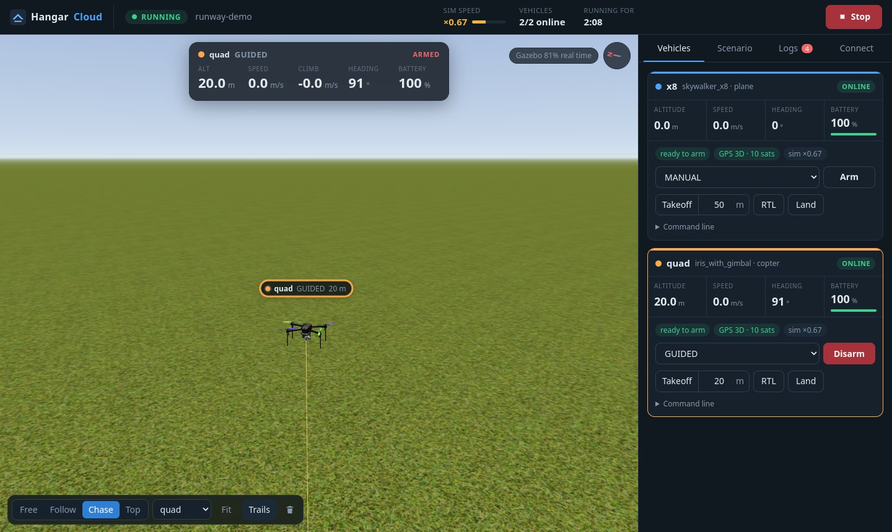
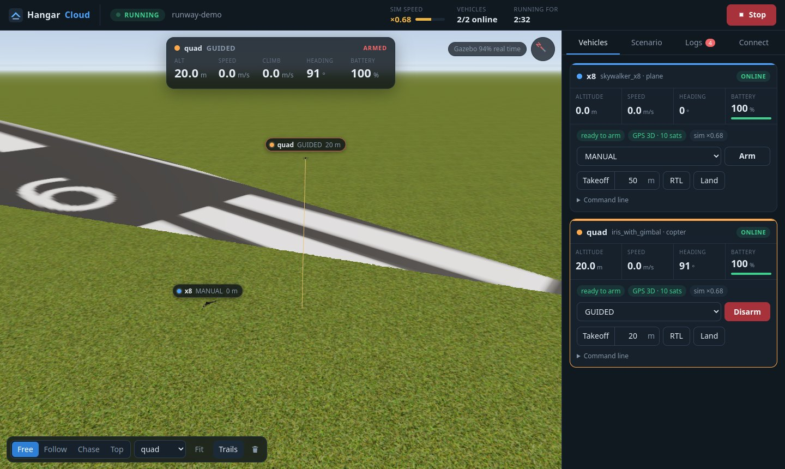
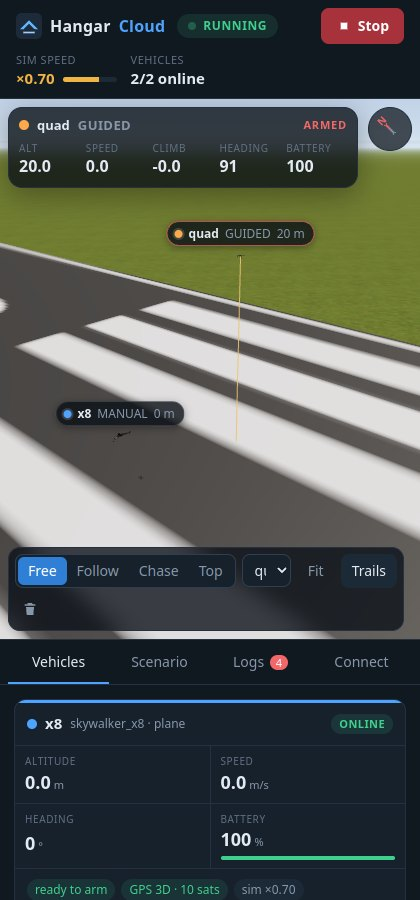
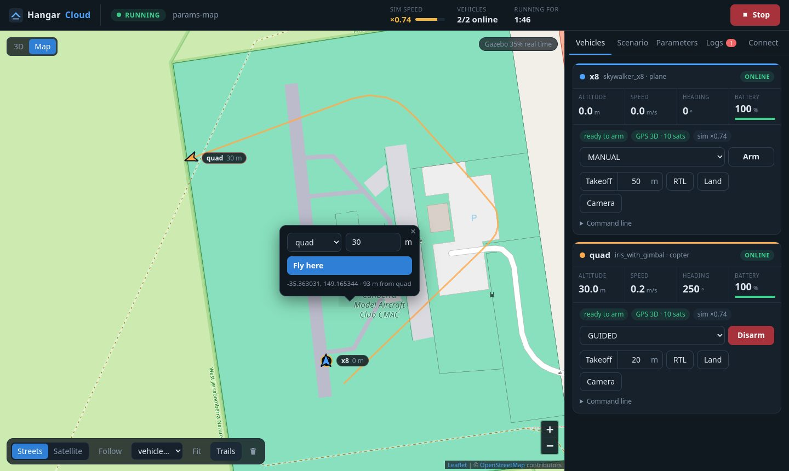
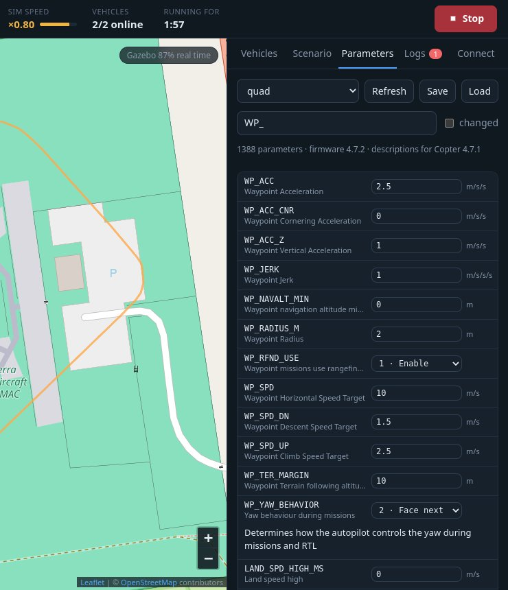
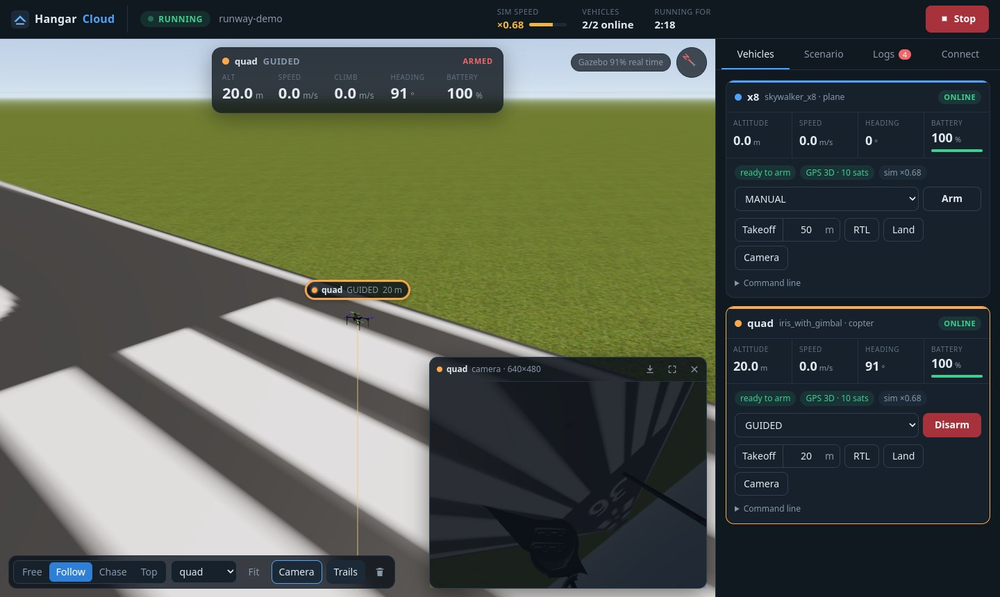
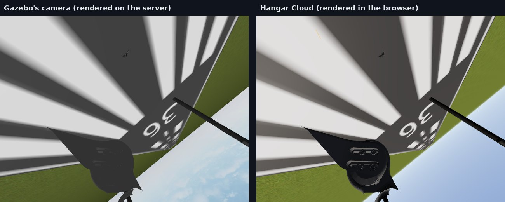

# Hangar Cloud

[English](README.md) · **Türkçe**

[Hangar](https://github.com/Enginar140/hangar)'ın ArduPilot SITL + Gazebo simülasyonlarını bir
Linux makinede (evdeki sunucu, laboratuvar bilgisayarı ya da küçük bir VPS) çalıştırır ve
Windows dahil her bilgisayardan tarayıcıyla kullanmanı sağlar. Canlı **3D görüntü**, araç
telemetrisi ve komutları, senaryolar, loglar, harita, parametre düzenleyici ve
QGroundControl / Mission Planner bağlantı bilgileri tek sayfada.



> **Durum: erken sürüm.** Aynı anda tek kullanıcı. 3D görüntü, tarayıcının çizdiği kameralar,
> harita, parametreler, komutlar, senaryolar, loglar ve MAVLink çıkışları çalışıyor. Görevler
> (mission) ve Gazebo'nun kendi kamera yayınları sırada ([Yol haritası](#yol-haritası)).

## Nasıl çalışır

```
Tarayıcı (Windows, Mac, Linux, tablet)            Linux makine
  3D görüntü (Three.js) ◄── WebSocket ────────  hangar-cloud
  araçlar, komutlar, loglar ◄── HTTP ─────────    ├─ Hangar: Gazebo + ArduPilot SITL'ler + MAVLink router
                                                  └─ Gazebo köprüsü: sahne ve konumlar (gz-transport)
QGroundControl / script ◄──── MAVLink TCP ────  Bağlan sekmesinde eklediğin çıkışlar
```

- **3D görüntüyü sunucu değil, senin tarayıcın çizer.** Küçük bir köprü Gazebo'dan sahneyi
  (modeller, mesh'ler, arazi) ve konumları okur, saniyede yaklaşık 30 kez WebSocket ile gönderir.
  Three.js bunları senin bilgisayarının GPU'sunda çizer. Gazebo sunucuda penceresiz çalışır, bu
  yüzden ekran kartı olmayan bir makine bunun için yeterlidir.
- Mesh'ler (`.dae`, `.obj`, `.stl`, `.gltf`), dokular ve arazi sunucudan yüklenir. Sunucu yalnızca
  o anki sahneye ait dosyaları verir.
- [hangar-earth](https://github.com/Enginar140/hangar-earth) dünyaları gerçek arazileri ve uydu
  görüntüleriyle, Gazebo'nun kullandığı yüksekliklerin aynısıyla görünür.
- Gerisi (Gazebo ve SITL'leri başlatmak, portlar, MAVLink) Hangar'ın kendi kodudur. Bir senaryo
  terminal arayüzünde de tarayıcıda da aynı davranır.

| | |
|---|---|
|  |  |

## Gerekenler

Linux makinede:

- **Hangar** kurulu ve `hangar doctor` sorunsuz olmalı: ArduPilot SITL, Gazebo Harmonic ve araç
  modelleri. [Hangar'ın kurulum rehberine](https://github.com/Enginar140/hangar/blob/main/README.tr.md#kurulum) bak.
- 3D görüntü için **Gazebo'nun Python bağlantıları**. Ubuntu'da Gazebo Harmonic ile gelir
  (`python3-gz-transport13`). Yoksa diğer her şey yine çalışır, sayfa 3D görüntünün kapalı olduğunu
  söyler.
- [uv](https://docs.astral.sh/uv/).

Kendi bilgisayarında: WebGL destekli güncel bir tarayıcı (Chrome, Edge, Firefox, Safari).

## Kurulum ve çalıştırma

```bash
uv tool install git+https://github.com/Enginar140/hangar-cloud
hangar-cloud serve
```

Giriş anahtarı (token) içeren bir bağlantı yazar:

```
hangar-cloud 0.2.0
  open  http://127.0.0.1:8080/?token=6vQ...
```

Anahtar `~/.local/share/hangar/cloud/token` dosyasında saklanır, yeniden başlatınca değişmez.
`hangar-cloud token` anahtarı yazar, `hangar-cloud token --new` yenisini üretir (eski
bağlantılar çalışmaz olur).

### Başka bir bilgisayardan erişmek

Birini seç:

- **SSH tüneli** (hiçbir port açmadan, VPS için de olur):
  `ssh -L 8080:localhost:8080 sen@sunucu`, sonra kendi bilgisayarında
  `http://localhost:8080/?token=...` adresini aç. Windows'ta `ssh` PowerShell'de hazır gelir.
- **Ev ağı**: `hangar-cloud serve --host 0.0.0.0` ile çalıştır ve
  `http://<sunucu-ip>:8080/?token=...` adresini aç.
- **VPN** ([Tailscale](https://tailscale.com) ya da WireGuard): sunucu, yalnızca senin
  cihazlarının erişebildiği özel bir adres alır. QGroundControl bağlamanın da en güvenli yolu budur.
- **İnternette HTTPS**: `serve`'ü `127.0.0.1`'de bırak, önüne bir ters vekil (reverse proxy) koy.
  [Caddy](https://caddyserver.com) ve bir alan adıyla şu `Caddyfile` yeterlidir (sertifikayı
  Caddy kendisi alır):

  ```
  sim.ornek.com {
      reverse_proxy 127.0.0.1:8080
  }
  ```

### Sürekli çalışsın

Bir systemd kullanıcı servisi makineyle birlikte başlatır:

```ini
# ~/.config/systemd/user/hangar-cloud.service
[Unit]
Description=Hangar Cloud

[Service]
ExecStart=%h/.local/bin/hangar-cloud serve
Restart=on-failure

[Install]
WantedBy=default.target
```

```bash
systemctl --user enable --now hangar-cloud
loginctl enable-linger $USER   # oturumu kapatınca da çalışmaya devam etsin
```

## Kullanım

- Üstte **Start / Stop**. Çubuk simülasyon hızını gösterir (×1 = gerçek zaman). ArduPilot'un arm
  olabilmesi için bir süre *simülasyon* zamanı geçmesi gerekir, yavaş bir simülasyonda bu daha
  uzun sürer.
- **Vehicles (Araçlar)**: her araç için bir kart: irtifa, hız, yön, batarya, arm'a hazır olma,
  GPS ve simülasyon hızı. Uçuş modunu aracın kendi listesinden seç, arm/disarm et, yazdığın
  irtifaya kalkış yap, RTL, iniş; geri kalan her şey için komut satırı:
  `param set WP_SPD 8`, `goto -35.3620 149.1652 40`.
- **3D görüntü**: sürükleyerek etrafında dön, sağ tıkla sürükleyerek kaydır, tekerlekle yakınlaş.
  Bir araca (ya da etiketine, kartına) tıklayınca seçilir; üstteki panel irtifasını, hızını,
  tırmanma hızını, yönünü ve bataryasını gösterir. Kamera modları: **Free** (serbest),
  **Follow** (araç hareket ederken etrafında döner), **Chase** (arkasından) ve **Top** (yukarıdan,
  kuzey yukarıda); `1`-`4` tuşları, serbest için `Esc`. Her aracın kendi rengi ve uçtuğu yerin
  **izi** vardır (*Trails* kapatır, çöp kutusu temizler). *Fit* tüm araçları gösterir.
- **Camera (Kamera)**: seçili aracın kamerası 3D görüntünün üstünde bir pencerede (`C`); tüm
  görüntüyü kaplayabilir (`F`), resmi PNG olarak kaydedebilir. Bkz.
  [Araç kameraları](#araç-kameraları-tarayıcının-çizdiği).
- **Harita** (sol üstteki *Map* düğmesi ya da `M`): her araç yönü, irtifası ve izlediği yolla,
  OpenStreetMap ya da uydu görüntüsü üzerinde. **Haritaya tıklayıp aracı oraya uçur**: aracı ve
  irtifayı seç, *Fly here* (araç GUIDED moda geçer; komut satırındaki `goto ENLEM BOYLAM İRTİFA`
  ile aynı). *Follow* seçili aracı ortada tutar. Gazebo'suz araçlar da burada görünür.
- **Parameters (Parametreler)**: aracın tüm parametreleri, sekme açılınca okunur. Ada göre ara;
  *Get descriptions*'a basınca açıklamalara göre de (aracın firmware sürümü için ArduPilot'un
  listesi, autotest.ardupilot.org'dan bir kez indirilip saklanır). Değeri değiştirip Enter'a bas;
  seçenekli ve bitmask parametreler liste ve kutucuklarla gelir, olağan aralığın dışındaki değerler
  önce sorulur. *changed* okumadan beri değişenleri gösterir (yer istasyonunun yaptıkları dahil).
  *Save* `.param` dosyası indirir; *Load* bir dosyayı araçla karşılaştırıp farkları uygular.
- **Scenario (Senaryo)**: kayıtlı ya da örnek bir senaryo yükle, YAML'ını düzenle
  ([Hangar'ınkiyle](https://github.com/Enginar140/hangar/blob/main/README.tr.md#senaryo-dosyası) aynı
  biçim), uygula ve kaydet. Sorunlar başlatmadan önce gösterilir.
- **Logs (Loglar)**: Hangar'ın yazdığı her şey, araçların mesajları dahil (PreArm hataları, mod
  değişiklikleri), filtrelerle.
- **Connect (Bağlan)**: MAVLink çıkışları, simülasyon çalışırken değiştirilebilir. Windows'ta
  QGroundControl ya da Mission Planner için `tcpin:0.0.0.0:5790` ekle ve TCP `sunucu:5790`'a
  bağlan. Her aracın kendi script'lerin için iki boş SITL portu da vardır (orada listelenir).

| | |
|---|---|
|  |  |

### Başka bir SITL'in yanında

Bir senaryo SITL'lerini 0. instance'tan başlatır (MAVLink `tcp:5760`'ta). Makinede zaten başka bir
SITL çalışıyorsa başlatma öncesi kontrol dolu portları söyler; senaryoya `first_instance: 3` (boş
herhangi bir sayı) ekle, her instance portları 10 kaydırır.

## Araç kameraları, tarayıcının çizdiği



Gazebo bir kamerayı sunucuda çizer, H.264'e çevirir ve yayınlar. Bu sunucuya GPU ve işlemci
yükü getirir, simülasyonun gerçek zamandan yavaş çalışmasının en yaygın sebebidir. Hangar Cloud
bunun yerine **kameranın görüntüsünü senin tarayıcında çizebilir**, zaten 3D gösterdiği aynı
sahneden:

- Kamera sensörü olan bir model (iris gimbal'i ya da Hangar'ın `camera:` ile eklediği) o
  sensörün konumunu, görüş açısını ve çözünürlüğünü kullanır; ArduPilot gimbal'i oynattıkça
  görüntü de döner.
- Kamerası olmayan bir modelde kamera, Hangar'ın takacağı yere konur (modelin `camera_pose`'u ya
  da senaryodaki `camera.pose` ve `camera.fov`) ve *browser only* diye işaretlenir.



Görüntü Gazebo'nunkiyle aynı bakış açısıdır, ama Three.js çizer: ışık, gökyüzü ve malzemeler
biraz farklı görünür, görüntü gürültüsü ve lens bozulması yoktur. Sadece tarayıcında vardır;
sunucudaki programlar (OpenCV, ROS, otopilot) onu görmez. Onlar için
[Hangar'ın kamera yayınlarını](https://github.com/Enginar140/hangar/blob/main/README.tr.md#kameralar)
kullanmaya devam et.

Görüntüyü tarayıcıda işlemek için, örneğin OpenCV.js ya da TensorFlow.js ile:

```js
// tarayıcının konsolunda ya da sayfaya yüklediğin bir script'te
hangar.cameras('quad')                  // [{name: 'camera', width: 640, height: 480}, ...]
const img = hangar.grabFrame('quad')    // ilk kameranın ImageData'sı
const img2 = hangar.grabFrame('quad', 1, 1280)   // ikinci kamera, en fazla 1280 piksel genişlik
```

## Güvenlik

Anahtar, makinedeki simülasyonların tam kontrolünü verir: şifre gibi sakla. Giriş çerezi
`HttpOnly` ve `SameSite=Strict`'tir, başka sitelerden gelen istekler reddedilir. Bağlantı kendi
ağının dışına çıkıyorsa HTTPS (ya da SSH tüneli veya VPN) kullan. MAVLink portlarını internete
açma; onlar için doğru araç VPN'dir.

## Yol haritası

1. **Gazebo'nun kendi kamera yayınları tarayıcıda**: WebRTC ile
   ([MediaMTX](https://github.com/bluenviron/mediamtx) üzerinden), başka bilgisayarlardaki OpenCV
   için de RTSP. Tarayıcının çizdiği kamera zaten var.
2. Haritada **görevler**: indirme, çizme, yükleme; geofence ve rally noktaları.
3. Gazebo, ArduPilot ve modellerle **Docker imajı**: VPS'te ya da Windows'ta (WSL2'li Docker
   Desktop) tek komutla çalıştırmak için.
4. Birden çok kullanıcı, her birinin kendi simülasyonları.

## Lisanslar

Hangar Cloud [MIT](LICENSE) lisanslıdır. İçinde [three.js](https://threejs.org) (MIT,
[lisans](src/hangar_cloud/web/vendor/three/LICENSE)) ve [Leaflet](https://leafletjs.com) (BSD-2-Clause,
[lisans](src/hangar_cloud/web/vendor/leaflet/LICENSE)) bulunur. Harita karoları
[OpenStreetMap](https://www.openstreetmap.org/copyright) ve Esri World Imagery'den doğrudan
tarayıcına gelir, kaynakları haritada yazar; parametre açıklamaları istediğinde ArduPilot'un
autotest sunucusundan gelir. Kendisi başka hiçbir şey kurmaz: ArduPilot
(GPL-3.0), Gazebo (Apache-2.0) ve araç modelleri Hangar üzerinden gelir; Hangar bir şey indirmeden
önce sorar ve lisansını gösterir. ArduPilot ve Gazebo ayrı programlar olarak çalışır. Böyle bir
sunucuyu başkalarına açarsan, gösterdiğin modellerin ve dünyaların lisanslarına bak; bazı örnek
modeller lisans belirtmiyor.

## Geliştirme

```bash
git clone https://github.com/Enginar140/hangar-cloud && cd hangar-cloud
uv sync
uv run pytest -q
uv run ruff check src tests scripts
uv run hangar-cloud serve
```

Tarayıcı kodu derleme adımı olmayan düz ES modülleridir: `src/hangar_cloud/web/*.js` dosyalarını
düzenleyip sayfayı yenilemen yeterli.
